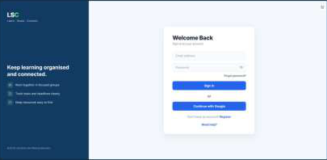
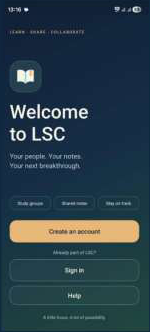
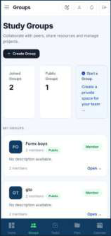

# LSC Learn Share Connect

LSC gives students and lecturers one place to organise study groups, share files, track tasks and manage deadlines. The responsive website supports desktop and mobile browsers. The Kotlin Android app gives students access to the same workspace from a phone.

[Live website](https://lsc.up.railway.app/) · [Android source](https://github.com/MJjimmy/LSC-APP) · [Watch the narrated demo on OneDrive](https://advtechonline-my.sharepoint.com/personal/st10439690_rcconnect_edu_za/_layouts/15/stream.aspx?id=%2Fpersonal%2Fst10439690%5Frcconnect%5Fedu%5Fza%2FDocuments%2FMoblie%2Emp4&referrer=StreamWebApp%2EWeb&referrerScenario=AddressBarCopied%2Eview%2E5d842752%2Db8bd%2D4e35%2D910a%2D9d707d3d3b04&share=cQqiQYOt3kYyQq8vYWGr%5FcS5EgUDMXQNTaOfu7S%5F2thdUi2eMg)

## What you can do

- Create or join public and private study groups. Group owners can review join requests and invite members.
- Assign tasks, update their status and use the calendar to track deadlines.
- Share documents and images through the group file library or chat. Downloads check group membership.
- Manage a student or lecturer profile, recover a password and set notification preferences. Email and SMS delivery depend on the deployment configuration.

## Website and Android design

The website uses a sidebar on desktop and responsive navigation on smaller screens. After signing in, users reach the dashboard and can open a group's workspace to access its tasks, members, files and chat.

The Android app opens on a native Kotlin/XML welcome screen. Its WebView loads the hosted workspace, while the app handles device actions such as file selection and back navigation. The Google sign-in flow uses the system browser and is designed to return to the app through a one-time session exchange.

Both interfaces use the same PHP application and MySQL database on Railway. The PHP router receives requests, checks the session and permissions, and reads or updates the shared records. A task saved on one platform is available to the other when it reads the same records. Uploads sit outside the public web root and downloads pass through the application's permission checks.

### Website sign-in

### Android welcome screen

### Android study groups

## Changes since the prototype

| Area | Change |
| --- | --- |
| Study groups | Private groups gained join-request moderation and invitations. Group tasks, deadlines, chat and shared files are accessible from the same workspace. |
| Collaboration | Chat attachments and the recent-files panel let students find resources alongside the conversation. Downloads check membership before serving a group file. |
| Android v1.3 | Added the Android document picker, multiple-file selection and authenticated downloads. |
| Android v1.4.2 UI branch | Added a themed launch screen, light content surfaces, connection recovery and changes to navigation and sharing. |
| Website production branch | Added email verification, a production Railway runtime and GitHub Actions release checks. |

## GitHub Actions and Azure Pipelines

We use GitHub to track source changes across the website and Android repositories. The [website release workflow](https://github.com/MJjimmy/LSC/blob/deploy/railpack/.github/workflows/lsc-web.yml) lints PHP, runs regression checks and builds the production runtime for Railway.

The [Android workflow](https://github.com/MJjimmy/LSC-APP/blob/master/.github/workflows/android.yml) runs on pushes to configured branches, pull requests and manual runs. It uses Java 25, verifies the Gradle wrapper, runs the debug unit tests and builds a debug APK. The workflow uploads the APK and test reports as artifacts.

~~~bash
./gradlew :app:testDebugUnitTest :app:assembleDebug
~~~

The [Task 2 Android run](https://github.com/MJjimmy/LSC-APP/actions/runs/39258572727) is the run referenced in the project report, which records **28 JUnit tests with zero failures**. The artifacts are for debug builds. A Google Play release requires a signed build and separate device checks.

[Website Actions](https://github.com/MJjimmy/LSC/actions) · [Android Actions](https://github.com/MJjimmy/LSC-APP/actions) · [Azure DevOps project](https://dev.azure.com/ST10439690/Learn%20Share%20Connect)

## Run the website locally

You need PHP 8.2 or later with PDO MySQL, mbstring and cURL, a MySQL 8 or MariaDB 10.4+ database, and write access to `storage/uploads`.

1. Copy `.env.example` to `.env` and set `MYSQLHOST`, `MYSQLPORT`, `MYSQLDATABASE`, `MYSQLUSER` and `MYSQLPASSWORD`.
2. For a fresh database, import `database/init.sql`. For an existing database, back it up and follow the migration instructions for your branch.
3. Make `storage/uploads` writable and serve `public/` as the document root.
4. From the repository root, start the local server and open [localhost:8000](http://localhost:8000).

~~~bash
php -S 127.0.0.1:8000 -t public public/router.php
~~~

For production, follow the configuration in [`deploy/railpack`](https://github.com/MJjimmy/LSC/tree/deploy/railpack). That branch uses nginx and PHP-FPM and exposes `/healthz`. Configure `APP_ENV=production`, set `APP_URL` to the public HTTPS origin, and use persistent storage for uploads. Keep database, email, SMS and Google sign-in credentials in environment variables. See [`.env.example`](https://github.com/MJjimmy/LSC/blob/deploy/railpack/.env.example) for branch-specific settings.

## Project documentation

- [Project documentation](docs/LSC_Project_Documentation.docx)
- [Institutional overview](docs/LSC_Institutional_Overview.md)
- [Android build instructions](https://github.com/MJjimmy/LSC-APP#build-and-test)

Developed by **HatchSoft, Group 6** for Work Integrated Learning 3B.
