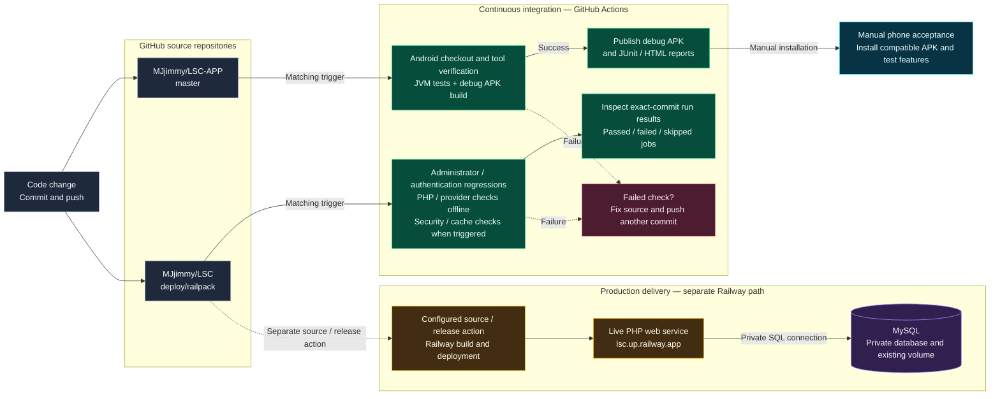
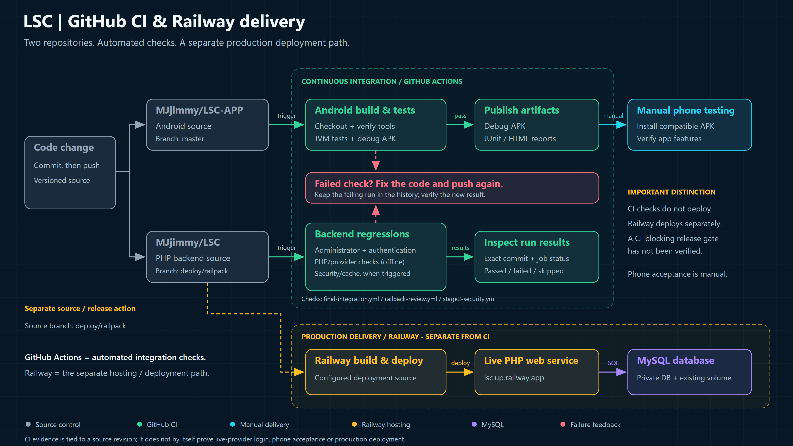

# LSC — GitHub CI and Railway delivery flow

This diagram describes **LSC's existing flow**. It is documentation, not a new workflow or a deployment configuration change.

- **Android source:** `MJjimmy/LSC-APP`, branch `master`.
- **Backend source:** `MJjimmy/LSC`, deployment branch `deploy/railpack`.
- **CI:** GitHub Actions checks source and publishes the Android build/test artifacts.
- **Delivery:** Railway deploys the PHP web service separately; that service connects to MySQL.
- **Manual acceptance:** installing a compatible APK and testing the app on a physical phone remain separate tasks.

> **Important:** A Railway deployment gate that blocks on GitHub CI results has not been verified. The deployment arrow therefore starts from source/release action, **not** from the tests-passed node. A green workflow also does not mean every job ran; inspect skipped jobs and the exact source revision.

## GitHub-native Mermaid diagram

## Presentation-ready version

The image below is the same flow in a 16:9 presentation layout. The Mermaid block above is editable directly in GitHub; the SVG is also provided for vector editing.

[Open the editable SVG](assets/LSC-CICD-Flow.svg)

## Which workflows are represented?

| Area | Workflow file | What the diagram represents |
|---|---|---|
| Android | `MJjimmy/LSC-APP/.github/workflows/android.yml` | Checkout/tool verification, JVM tests, debug APK assembly and artifact publication. |
| Backend integration | `.github/workflows/final-integration.yml` on `deploy/railpack` | Combined administrator and authentication regression checks. |
| PHP/provider review | `.github/workflows/railpack-review.yml` on `deploy/railpack` | Offline provider/controller and PHP checks. The recorded run's runtime/database job was skipped. |
| Security/cache | `.github/workflows/stage2-security.yml` on `deploy/railpack` | Security, cache and browser regressions when that workflow's conditions match. |

Workflow conditions differ. This does **not** mean every registered workflow runs on every push, all historical workflows are passing, or all workflows tested the latest deployment revision. The separate historical `main` CI is not depicted as the current production branch's pipeline.

## Verified example runs

- [Android build and tests — run 40415126298](https://github.com/MJjimmy/LSC-APP/actions/runs/40415126298): source `1a46282` on `master`; the actual downloaded report showed **42 tests, 0 failures/errors/skips**. This is not the newer local 63-test build.
- [Combined backend checks — run 40624555112](https://github.com/MJjimmy/LSC/actions/runs/40624555112): source `2241e48` on `deploy/railpack`.
- [Railpack review — run 40624555069](https://github.com/MJjimmy/LSC/actions/runs/40624555069): source `2241e48`; inspect the skipped runtime/database job rather than treating it as passed.
- [Stage 2 security/cache checks — run 40623329843](https://github.com/MJjimmy/LSC/actions/runs/40623329843): source `03eb2a6`, an earlier revision than `2241e48`.

The diagram contains no credentials. It does not represent an automatic Play Store release, a real-provider authentication test, or proof of authenticated production/database acceptance.
